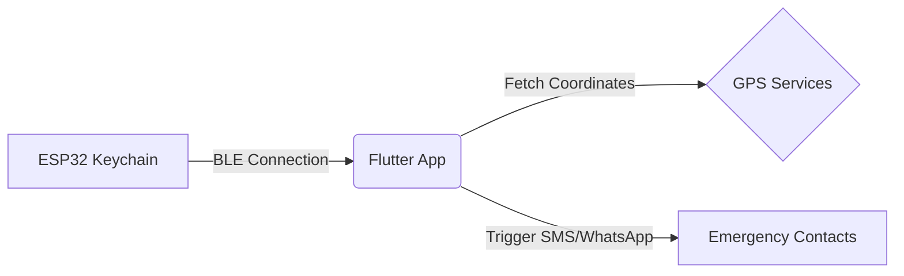

<div align="center">
  

  # SafeHer: SOS Keychain & Safety App
  
  **Empowering personal safety through smart hardware and seamless software.**

  [](https://flutter.dev/)
  [](https://dart.dev/)
  [](https://www.espressif.com/)
  [](https://isocpp.org/)
  [](LICENSE)
</div>

## 🎥 App Preview

<div align="center">
  <a href="https://res.cloudinary.com/dukjtmdtn/video/upload/v1777288040/demo_video_bwcszu.mp4">
    
  </a>
  <br>
  <em>Click the image above to watch the demo video.</em>
</div>

## 🌟 Overview

**SafeHer** is an integrated personal safety ecosystem combining a custom ESP32-based hardware keychain with a cross-platform Flutter application. Designed to provide peace of mind, SafeHer allows users to instantly trigger emergency SOS alerts with a physical button press, immediately notifying emergency contacts with real-time location data.

## ✨ Key Features

### Hardware (SOS Keychain)
* **Instant Activation:** Dedicated tactile button for quick 2-second SOS triggering.
* **Bluetooth Low Energy (BLE):** Reliable, low-latency connection to your smartphone.
* **Audio-Visual Feedback:** Built-in buzzer and LED indicator for device status and confirmation.
* **Compact & Portable:** Designed to be carried effortlessly on any keychain.

### Mobile Application (Flutter)
* **Seamless BLE Integration:** Auto-discovery and robust background connection handling with the keychain.
* **Multi-Channel Alerts:** Dispatches emergency signals via SMS and WhatsApp concurrently.
* **Real-Time Location Tracking:** Embeds precise GPS coordinates into the alert messages.
* **Comprehensive SOS History:** Detailed logs of past alerts including timestamp, location, and notified contacts.
* **Smart Notifications:** Persistent SOS alerts, connection status updates, and interactive "I'm Safe" actions.
* **Highly Customizable:** Configure emergency contacts, alert preferences, and auto-reconnect behaviors.

## 🏗️ System Architecture

The solution operates on a simple but highly reliable client-peripheral architecture:

1. **Peripheral:** ESP32 Microcontroller (Hardware) 
2. **Client:** Flutter Mobile Application (Android/iOS)
3. **Communication:** Bluetooth Low Energy (BLE)



## 🚀 Getting Started

### Prerequisites
* Flutter SDK (3.10.4+)
* Android Studio (with Android SDK & Build Tools)
* ESP32 Development Board (for hardware build)
* Arduino IDE or PlatformIO

### 1. Hardware Setup
1. Open the `hardware/` directory.
2. Flash `hardware/main.ino` to your ESP32 board.
3. **Pin Configuration:**
   - SOS Button: `GPIO 15`
   - Control Button: `GPIO 5`
   - Buzzer: `GPIO 4`
   - LED: `GPIO 2`

### 2. App Installation
```bash
# Navigate to the frontend directory
cd frontend

# Install dependencies
flutter pub get

# Build the APK (Debug)
flutter build apk --debug
```
*Locate the compiled APK in: `build/app/outputs/flutter-apk/app-debug.apk`*

## 📱 App Onboarding Flow
1. **Launch:** Swipe through the introductory screens.
2. **Permissions:** Grant location, Bluetooth, SMS, and notification permissions for full functionality.
3. **Pair:** Navigate to "Pair Device", scan, and connect to `SOS_KEYCHAIN`.
4. **Configure:** Add trusted contacts under the "Contacts" tab, enabling SMS or WhatsApp preferences.

## 🧪 Testing

### Triggering an Alert
* **Hardware:** Hold the SOS button (`GPIO 15`) for 2 seconds. The app will intercept the BLE signal and execute the emergency flow.
* **Software:** Use the "Test SOS Alert" button directly on the app's home screen.

*See [`BUILD_INSTRUCTIONS.md`](BUILD_INSTRUCTIONS.md) for an exhaustive testing and troubleshooting guide.*

## 📂 Project Structure

* `/frontend` - Complete Flutter application source code.
* `/hardware` - ESP32 firmware source code.
* `/webpage` - Assets for the project website/landing page.

## 🛠️ Built With

* **[Flutter](https://flutter.dev/)** - UI Toolkit
* **[flutter_blue_plus](https://pub.dev/packages/flutter_blue_plus)** - Bluetooth LE communication
* **[geolocator](https://pub.dev/packages/geolocator)** - Location services
* **ESP32** - Hardware MCU

---
<div align="center">
Made with ❤️ to keep you safe.
</div>